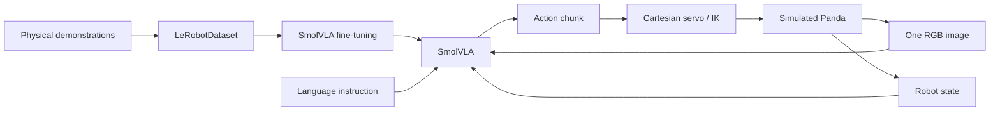

# VLA Robot Lab

An educational language-controlled Panda manipulation project using **Isaac Sim,
Hugging Face LeRobot, and pretrained SmolVLA**. Follow the pipeline from physical
expert demonstrations to a LeRobot dataset, fine-tuning, closed-loop robot control,
and honest generalization evaluation.

**Current validation status:** the existing Isaac Sim scene and synchronized RGB
capture pass runtime checks; the scripted expert achieved **100/100** randomized
successes. The real dataset contains **50 demonstrations / 3,914 frames**, with
45/5 train/validation episodes. Three replays have been visually reviewed.
Learned-policy milestones are being validated next. See
[the experiment log](docs/experiments.md); expert success is separate from VLA success.



The policy directly predicts Cartesian gripper poses and opening commands. The
scripted expert reads simulator truth only to create demonstrations. Learned
inference receives pixels, proprioception, and text. The system does not use a
detector, external VLM/LLM planner, MoveIt, reinforcement learning, or a web frontend.

## Installation and environment

Test machine: Ubuntu 24.04, RTX 5070 Ti (16 GB), driver 595.91.07, Miniforge.
The project reuses the existing standalone Isaac Sim installation. Allow disk/network
space for model checkpoints and generated datasets.
The host's existing ROS Jazzy is retained. **ROS is not installed into Conda** and
is not required for this standalone V1.

```bash
./scripts/setup.sh
conda activate vlarobot
python scripts/download_model.py
python scripts/check_environment.py
```

`vlarobot` contains LeRobot, PyTorch, and SmolVLA libraries. Isaac Sim runs using
its existing bundled Python at `~/isaacsim/python.sh`. For another installation:

```bash
export ISAAC_SIM_PATH=/path/to/your/existing/isaacsim
```

A private local subprocess connection transports RGB/state observations and
robot actions between these interpreters. `setup.sh` installs neither Isaac Sim
nor ROS. System Python and unrelated environments are untouched. The detected
simulator is `6.0.0-rc.59+release.41464.5f2772bc.gl`; its installed APIs are checked
against the current official documentation. NVIDIA assets may download on first
use. There is no cloud runtime or mandatory external logging account.

See [environment details](docs/environment.md),
[the implementation plan](docs/implementation_plan.md), and versioned configuration
files under `configs/`. Run all plain `python` commands from the repository root
with `vlarobot` active; shell scripts select the environment automatically.

## Launch the simulator

```bash
./scripts/run_simulation.sh
./scripts/run_simulation.sh --headless --seed 7
python -m src.control.teleoperation
```

The simulator demo uses the explicitly labeled scripted expert. The native viewer
shows the scene, command, seed, step, and status. `outputs/scene.png` captures the
actual rendered camera view. The optional terminal jogger lets you inspect the
same Cartesian action interface manually.

The scene has four colored cubes and four physical open-top boxes. Reset varies
cube positions with reachability bounds, separation constraints, and box exclusion
zones. One RGB camera sees the workspace. Physics runs at 120 Hz, with a 10-Hz
action/observation interface.

## Validate the teacher and collect demonstrations

```bash
python -m src.control.validate_expert --episodes 100
./scripts/collect_dataset.sh --episodes 50
python -m src.dataset.inspect
python -m src.dataset.visualize --episode 0 --play
python -m src.dataset.visualize --episode 17
python -m src.dataset.visualize --episode 42
python -m src.dataset.split
```

The collector refuses to run without a matching expert validation result above
95% on at least 100 randomized episodes. It keeps successful physical
demonstrations, and records the canonical task separately from its sentence.
Review several videos/contact sheets before training.

To collect more, use `--episodes 100`, `250`, `500`, or `1000` and a new `--root`.
`--resume` appends to a compatible collection. Existing roots are otherwise
protected from accidental overwrite.

## Dataset and action format

| Signal | Representation |
|---|---|
| RGB | `observation.images.camera1`, 256×256×3 uint8 at capture |
| State | 14 values: TCP XYZ/RPY, measured gripper width, seven joint angles |
| Language | Natural-language `task` string |
| Action | Seven values: absolute TCP target XYZ/RPY plus opening fraction |
| Outcome | Transition done/success plus separate episode metadata |

Units are metres/radians in the world/robot-base frame; gripper fraction is 0–1.
LeRobot stores video/Parquet plus schema, task indices, episode boundaries, and
normalization statistics. The default split makes 45 training and five validation
episodes from a 50-episode collection. Test scenes use a disjoint seed range;
held-out phrases and source/destination combinations are defined explicitly.

Read [architecture and coordinate frames](docs/architecture.md) and
[dataset/split details](docs/dataset.md) before changing this contract.

## Smoke test and train

Close the simulator to free GPU memory before training.

```bash
python scripts/smoke_test_vla.py
./scripts/train.sh
```

The smoke test loads genuine pretrained weights and runs CUDA inference on a
recorded observation. It reports input shapes, the 50×7 action chunk, VRAM, and
latency. The default training run is a **300-step sanity experiment**, using the
official LeRobot trainer. It is not a claim of a fully competent policy.

Settings are in `configs/training.yaml`. CUDA OOM retries halve batch size down
to one, with separate logs for each attempt. Training logs, memory samples,
checkpoint files, and held-out validation loss stay local. W&B is disabled.

After the sanity run and physical evaluation:

```bash
./scripts/train.sh --steps 3000 --output outputs/train/longer
```

See [training details](docs/training.md) for freezing, flow matching, normalization,
OOM behavior, and the difference between starting another fine-tune and resuming
optimizer state.

## Watch the learned policy

```bash
python -m src.inference.run_policy \
  --instruction "Put the green cube in the red box." \
  --checkpoint outputs/train/sanity/checkpoints/last/pretrained_model
```

Use `--headless` for recording without a window, `--seed` for reproducible scenes,
and `--n-action-steps 1` to replan every control step. The default predicts 50
actions, executes the first five, and then uses fresh observations. It does not
blindly execute one fixed episode trajectory. Videos and action/telemetry traces
are saved under `outputs/videos/`.

## Evaluate and analyze failures

```bash
./scripts/evaluate.sh
./scripts/evaluate.sh --episodes 50 --conditions position language composition \
  --output outputs/evaluation_50
```

Default evaluation conditions are training-scene replay, unseen positions,
unseen phrases, held-out color combinations, changed lighting, camera perturbation,
and cube scale. The output includes per-episode `results.csv`, Wilson confidence
intervals, a generated results table, videos, and failure traces.

Success requires the target cube to rest fully inside the right box, with the
gripper open and withdrawn for a stable interval. Failure classification is
conservative: wrong object, failed approach/grasp, wrong destination, dropped or
misplaced object, or timeout. Videos help distinguish ambiguous causes.

See [inference/evaluation](docs/inference.md) and
[actual experiment results](docs/experiments.md). Bad outcomes remain in reports.
No learned success rate has been asserted before completing the corresponding run.

## Troubleshooting

| Symptom | Check |
|---|---|
| ROS Python/plugin imports inside Conda | Reactivate the environment after setup; its `PYTHONPATH` is isolated. No ROS reinstall is needed. |
| CUDA unavailable / unsupported architecture | Run `scripts/check_environment.py`; use the pinned CUDA 12.8 PyTorch build for this Blackwell GPU. |
| First Isaac startup is slow | Inspect `outputs/logs/simulation.log`; extension loading, asset downloads, and shader compilation can take time. |
| Isaac exits before connecting | Read its log; verify both environments and the `.kit` dependencies. Set `VLAROBOT_SIM_PYTHON` for a custom interpreter. |
| Asset service unavailable | Set `VLAROBOT_FRANKA_USD` to a complete local Panda asset tree. |
| Empty camera image | Check synchronous rendering and camera placement; do not train on blank observations. |
| Expert gate refuses collection | Re-run validation after physics/control edits; inspect failed expert traces/videos. |
| Model moves in the wrong scale/frame | Verify action units, saved normalizer, state order, and pretrained feature overrides. |
| GPU OOM during training | Close Isaac; the runner retries smaller batches. Inspect preserved attempt logs. |
| Low loss, bad manipulation | Inspect dataset alignment and failures; expand coverage/recovery data and evaluate closed loop. |
| Existing experiment/dataset directory | Choose a new output path or the documented resume workflow; results are preserved by default. |

## Tests

```bash
python -m pytest -q
python -m ruff check src scripts tests
```

These tests cover contracts and the real LeRobot writer API. The tiny synthetic
writer fixture is temporary test data, never a substitute for physical robot
demonstrations. Physics/expert/model/training checks are separate runtime milestones.

## Limitations and next steps

This is a small, controlled pick-and-place experiment: one camera, four geometric
objects, fixed bin positions, narrow gripper orientation, and scripted successful
demonstrations. It has no guarantee of recovery, collision avoidance, arbitrary
language understanding, real-time hardware performance, or sim-to-real transfer.

Study [the learning notes](docs/learning_notes.md) for a walkthrough from pixels
and language to motor commands. They cover behavioral cloning, action chunks,
flow matching, embodiment, failure modes, and why this differs from an LLM/planner
system. Future versions can add manipulation tasks, Isaac Lab randomization,
ROS 2 using the existing Jazzy setup, real hardware, and eventually mobile and
industrial systems. Those extensions are documented, not implemented in V1.

## Primary references

- [LeRobot documentation](https://huggingface.co/docs/lerobot)
- [SmolVLA training guide](https://huggingface.co/docs/lerobot/smolvla)
- [Official base checkpoint](https://huggingface.co/lerobot/smolvla_base)
- [SmolVLA technical report](https://huggingface.co/papers/2506.01844)
- [Isaac Sim documentation](https://docs.isaacsim.omniverse.nvidia.com/latest/index.html)
