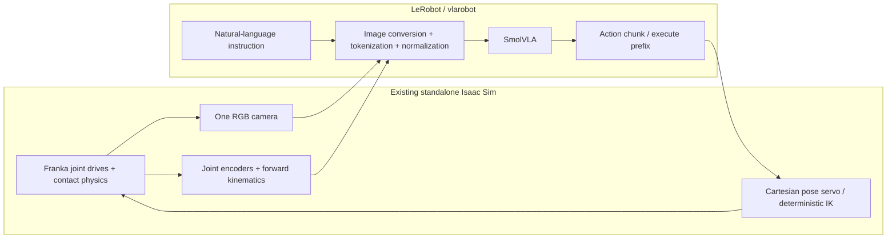
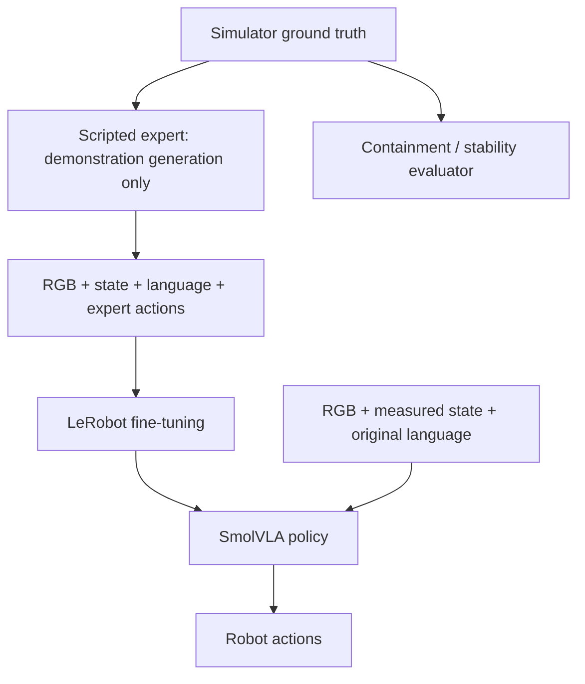

# Architecture and control contract

The central learned mapping is **RGB + language + measured robot state → robot
actions**. Isaac Sim and LeRobot live in separate Python processes because their
NumPy and packaging requirements conflict. That boundary transports arrays; it
does not add a perception or planning component.



## Observation

| Field | Shape at environment boundary | Meaning / units |
|---|---|---|
| `observation.images.camera1` | 256 × 256 × 3, uint8 | Single RGB camera, values 0–255 |
| `observation.state` | 14, float32 | TCP pose (6), gripper width (1), arm joint angles (7) |
| `task` | string | Original natural-language instruction |

State order:

```
[tcp_x, tcp_y, tcp_z, tcp_roll, tcp_pitch, tcp_yaw,
 gripper_width, panda_joint1, ..., panda_joint7]
```

Positions and gripper width are in metres. Angles are in radians. The state is
computed from joint measurements and the known robot model; it contains no cube
or container position. On hardware, encoders and calibrated forward kinematics
would provide the same information.

The policy boundary in `src/inference/policy.py` explicitly constructs a new
dictionary containing only the two observation fields and instruction. Extra
environment metadata cannot enter the model simply by being present elsewhere.

## Action

```
[target_x, target_y, target_z, target_roll, target_pitch, target_yaw, gripper_open]
```

These are **absolute TCP pose targets in the robot base/world frame**, followed
by a gripper opening fraction: 0 commands closed; 1 commands 0.08 m total opening.
The measured width may differ from the command when a cube prevents closure.

We chose absolute Cartesian targets rather than accumulated deltas: a predicted
target can be inspected directly, and errors do not accumulate through repeated
integration of a noisy delta. The learner still predicts seven continuous action
values. This is a deliberate choice within the requested end-effector interface.

The servo limits translation to 0.025 m per action interval, limits rotation
changes to 0.1 rad, clips the TCP to the configured workspace, and asks Lula IK
for joint targets. It reads the robot configuration only. It has no instruction,
object identities, destinations, obstacle map, or grasp state machine.

The V1 expert uses a downward gripper pose `(π, 0, 0)` in XYZ Euler angles. Servo
orientation limits allow a small cone around that pose. These orientation channels
have little variation in the dataset; this experiment does not teach arbitrary
6D grasping. End-effector control is often more embodiment-independent than joint
targets, but it still depends on TCP definition, joint limits, and gripper geometry.

## Frames and timing

- World/base: right-handed, Z up; Panda base at the origin; table top at Z = 0.
- X points into the reachable tabletop; Y spans its width.
- TCP: the center between the finger pads, 0.1034 m along hand-local +Z from
  `panda_hand`. Downward orientation maps this direction toward world −Z.
- USD camera: local −Z is viewing direction, +Y is image up. RGB arrays are HWC;
  LeRobot yields CHW float tensors, scaled to [0, 1]. No segmentation or depth.
- Physics: 120 Hz. Actions and dataset frames: 10 Hz (12 physics steps/action).
- Inference advances simulation in fixed control intervals. Physics pauses while
  the neural network computes. Simulation frequency is not wall-clock inference
  throughput; logs report both.
- RGB is rendered using Replicator synchronous capture with `delta_time=0.0`
  at the current physics state. A recorded pair
  `(observation_t, action_t)` is captured before executing that action. Outcome
  fields describe the transition to `t+1`.

## Action chunks and feedback

SmolVLA predicts 50 future actions per chunk. Our default uses the official
`select_action()` queue with `n_action_steps=5`: execute five actions, then run a
new prediction using fresh RGB and state. At 10 Hz, the policy gets a fresh
observation for planning every 0.5 simulated seconds. It observes after every
executed action, but the queued actions do not consume those images until the
next prediction. Set `--n-action-steps 1` to replan every control interval.

```mermaid
sequenceDiagram
  participant E as Environment
  participant P as SmolVLA
  E->>P: RGB_t, state_t, instruction
  P->>E: Predict 50 actions; use first 5
  Note over E: Execute actions t through t+4 with physics
  E->>P: New RGB_(t+5), state_(t+5), instruction
  P->>E: New action chunk
```

A long chunk reduces neural-network calls but delays visual correction. Shorter
execution prefixes improve responsiveness and cost more compute. We use
synchronous chunking for clarity, not asynchronous RTC or an entire open-loop
episode trajectory.

## Normalization and embodiment adaptation

The official SmolVLA processors apply per-dimension mean/std normalization to
state and actions using **training-split** statistics. Images use identity
normalization after conversion to [0, 1]. The postprocessor denormalizes actions
before the servo receives them. Processor configurations and statistics are saved
with checkpoints and loaded at inference.

The official base checkpoint describes six state/action dimensions and three
camera names from its original setup. Fine-tuning explicitly changes the input
schema to one RGB image and 14 state values, and the output schema to seven
actions. SmolVLA internally pads vectors to 32 dimensions. We retain its pretrained
weights; this is not a new action network trained from scratch.

## Teacher, learner, and scoring have different information



Canonical color labels support sampling, the teacher, and scoring. The small
instruction parser used for interactive scoring does not supply coordinates,
waypoints, or actions to the VLA. Unmodified text is the policy's only task input.

## Why this differs from an LLM commanding MoveIt

| Our VLA | Detector + LLM + motion planner |
|---|---|
| Learned image/text/state → continuous action distribution | Perception produces symbolic objects/poses |
| Fine-tunes on synchronized demonstrations | LLM chooses semantic commands or goals |
| Visual features condition a neural action expert | Planner computes explicit trajectories |
| IK only converts a predicted pose into joint commands | Planner uses an explicit world/obstacle model |
| Failures may arise from visual grounding, data coverage, or action prediction | Failures can often be traced to explicit detector/planner outputs |

SmolVLA has a vision-language backbone internally. That is part of the integrated
policy, not an external VLM generating a plan. The distinction is what the
learned model predicts and which component chooses the next motion.

## Version-specific implementation note

The installed Isaac Sim 6.0.0-rc.59 supplies `World`, `SingleArticulation`, and Lula IK, though these
APIs are marked deprecated in favor of experimental replacements. V1 records this exact installed build and uses this compact, documented robot-control interface rather than
introducing a larger planning framework. The RGB camera uses the current
`RtxCamera`/`CameraSensor` API. Migration is isolated to `src/simulation` and
`src/control/ik_controller.py`.

References: [SmolVLA](https://huggingface.co/docs/lerobot/smolvla),
[Lula IK](https://docs.isaacsim.omniverse.nvidia.com/latest/manipulators/manipulators_lula_kinematics.html),
[Isaac cameras](https://docs.isaacsim.omniverse.nvidia.com/latest/sensors/isaacsim_sensors_camera.html).
