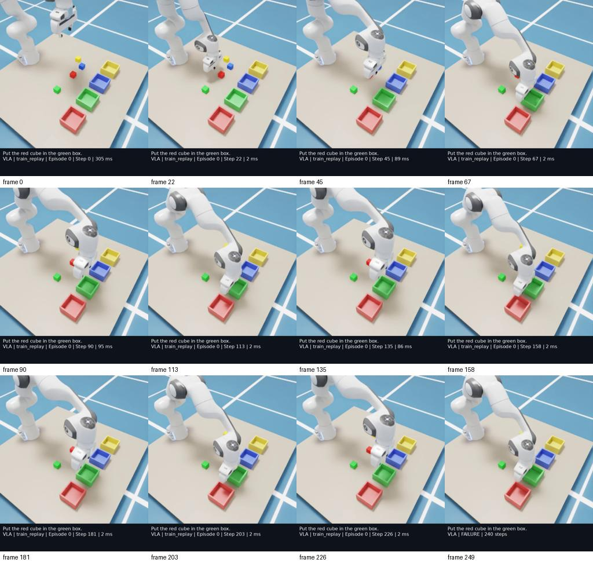
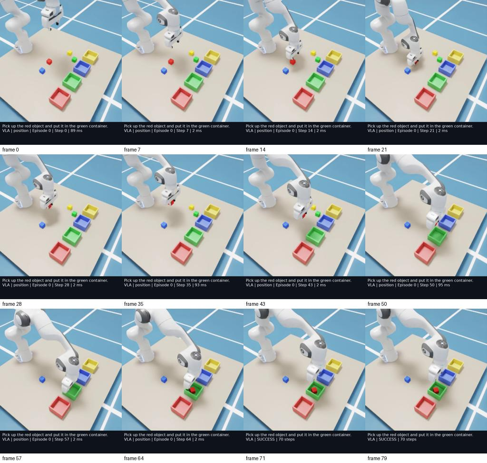
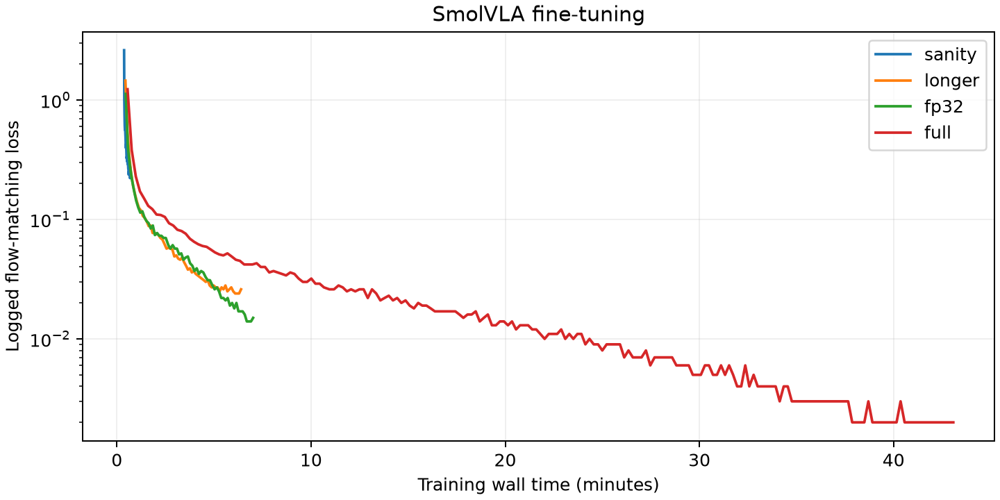

# Experiment log

This document records actual results only. A source file existing is not proof
that its runtime path works. Runtime results will be added at each completed gate.

## 2026-10-04 — machine and dependency inspection

Ubuntu 24.04.5, RTX 5070 Ti (16,303 MiB), driver 595.91.07, 31 GiB RAM, about
650 GiB free disk. Selected Python 3.12, PyTorch 2.11.0 + CUDA 12.8, LeRobot 0.6.1,
and the existing standalone Isaac Sim 6.0.0-rc.59. An initial redundant pip
installation was stopped and its task-created simulator environment removed.
The final design uses one Conda environment for learning libraries and Isaac
Sim's existing bundled Python. Existing ROS Jazzy remains on the host.

Measured CUDA check: an 8×8 matrix of ones multiplied by itself produced 8.0
on the GPU. `torch.cuda.is_available()` returned true and identified the RTX
5070 Ti. Detailed package/architecture output: `outputs/environment.json`.

## Contract tests

Eight tests passed after isolating inherited ROS Python paths. Tests covered
1,000 randomized scene layouts, whole-cube containment/resting height, Wilson
interval edge cases, task/phrase split separation, metric parsing, and the policy
input allow-list. These are software/geometry checks, not physical grasp trials.

A separate small synthetic LeRobot round-trip fixture caught a codec API change:
LeRobot 0.6.1 accepts `h264` rather than `libx264` in `RGBEncoderConfig`. The collector
uses the supported name. Synthetic API fixtures are temporary test files and are
never used as demonstrations, videos of robot behavior, training data, or results.

## Pretrained checkpoint load

The official SmolVLA checkpoint loaded on CPU with 450,046,176 parameters;
99,880,992 were trainable under the default frozen-backbone configuration.
`load_vlm_weights=False` avoids a redundant backbone download while the complete
SmolVLA checkpoint supplies its pretrained weights. This was a weight-loading
check, not an inference or training result. Log: `outputs/logs/pretrained-load.log`.

## Existing Isaac Sim scene and synchronization

The existing 6.0.0-rc.59 runtime renders the Panda, four cubes, and four open
containers with a 256×256 RGB camera. Its first launch took approximately 146 s;
subsequent warm launches took about 4.5 s before scene creation. Robot state has
14 components and actions have 7. Actual images: `outputs/scene.png` and
`outputs/scene_after_actions.png`.

`python scripts/check_simulation.py` passed against the real simulator. Capturing
an extra image changed the robot state by **0.0**; replaying 12 identical actions
with and without rendering also produced a maximum state difference of **0.0**.
The image changed after movement (mean absolute pixel difference 5.893). This
checks that RGB capture is synchronized and does not silently advance physics.

Two camera integration problems were fixed: the installed USD camera has a
double-precision orientation attribute, and render-only ticks did not trigger
its RGB annotator. The code now preserves the attribute type and uses official
Replicator synchronous capture with `delta_time=0.0`.

## Scripted expert development

The first two recorded diagnostic episodes failed: the teacher waited forever
for a placement pose within 6 mm, while the PD-controlled arm had a roughly 1 cm
steady tracking error. The cube was grasped and transported, but not released.
The teacher now releases just above the container rim (to give open fingers
clearance) and uses a physically attainable approach tolerance.

A subsequent 10-episode pilot achieved **9/10**. The remaining episode stopped
in the descent phase: its 7.4 mm pose error exceeded the 6 mm transition tolerance.
The descent tolerance was changed to 10 mm, within the grasp-pad region. A fresh
100-episode validation is required before demonstration collection. Diagnostic
logs and videos remain under `outputs/expert_debug/` and `outputs/expert_pilot/`.
These figures describe the scripted teacher, not SmolVLA.

## Scripted expert gate — passed

Fresh validation on seeds **10000–10099** achieved **100/100 successful episodes**,
with a Wilson 95% confidence interval of **96.3%–100%**. Tasks cycle through all
nine training color pairs and sample controlled language variations. These seeds
are separate from demonstration collection and learned-policy evaluation seeds.

Success requires the entire target cube inside the correct physical container,
resting near its floor, moving slower than 2 cm/s, and released with the gripper
retreated for eight consecutive control steps. No object attachment or pose
teleport is used during manipulation. Machine-readable results and two real
expert videos are under `outputs/expert/`. The collector checks the result and
an environment/controller fingerprint before writing demonstrations.

## Native viewer and dependency correction

The native GUI demo completed successfully in 76 control steps (7.6 simulated
seconds), showing the current instruction and episode status. Log:
`outputs/logs/gui-demo.log`; actual camera frame: `outputs/gui_scene.png`.

Dataset collection exposed a TorchCodec packaging mismatch: the generic PyPI
0.11.0 wheel requested `libnvrtc.so.13`, while our PyTorch wheel uses CUDA 12.8.
The collector continued through the explicitly selected supported PyAV backend.
The CUDA 12.8 TorchCodec wheel then exposed an optional missing NVIDIA NPP
library. V1 uses CPU video decoding, so the final compatible choice is the
official `torchcodec==0.11.0+cpu` wheel. Its import, the CUDA PyTorch computation,
and `pip check` all pass. This avoids adding an unused GPU video-decoder stack;
SmolVLA computation still uses CUDA. The environment checker now imports the
codec, since metadata-only version checks missed the shared-library mismatch.

## LeRobot demonstration dataset — passed

Collected **50/50** successful episodes on seeds **1000–1049**, without a rejected
trial, in **478.8 s**. The official v3.0 dataset contains **3,914 frames at 10 Hz**,
31 distinct instructions, nine canonical color pairs, and 50 unique scene seeds.
Episode duration is 7.0–9.1 s (mean 7.828 s). The state width is 14 and action
width is seven. Inspection: `datasets/pick_place_50/meta/inspection.json`.

Visual review of decoded dataset episodes **0, 17, and 33** confirmed approach,
physical closure, lift, transport, release, and retreat. Their real MP4 replays
and contact sheets are under `outputs/dataset_preview/`. Episode 33 also shows
a small incidental displacement of a neighboring cube; the task metric does not
penalize that. Expert success is not evidence of collision-free manipulation or
preserving every distractor's position.

The official split utility created **45 training episodes / 3,526 frames** and
**5 validation episodes / 388 frames**, with disjoint seed sets. Training retains
all nine canonical pairs. Validation normalization will come from the training
checkpoint. `datasets/splits/manifest.json` records exact indices and seeds.

## Pretrained CUDA forward pass — passed

`python scripts/smoke_test_vla.py` loaded the official pretrained SmolVLA weights
and consumed a real training-split observation. The output was finite with shape
**[1, 50, 7]**. Warm chunk inference took **78.9 ms** on the RTX 5070 Ti; PyTorch
peak allocated memory was **1,188.9 MiB**. The model has 450,046,176 parameters,
with 99,880,992 trainable under the selected frozen-backbone configuration.
Full input shapes and measurements: `outputs/smoke_test_vla.json`.

These are single-example smoke-test measurements after warm-up, not an end-to-end
control benchmark or a demonstration of task competence. Base outputs were not
executed as evidence of success.

## Training integration issue

The initial sanity run reached its first backward pass and failed with
`_amp_foreach_non_finite_check_and_unscale_cuda` unsupported for BF16 gradients.
LeRobot 0.6.1 falls back to PyTorch's default CUDA FP16 autocast for SmolVLA when
`use_amp=true`, creating an incompatible GradScaler for the loaded BF16 weights.

Considered solutions: disable AMP; change the checkpoint's weight dtypes; select
BF16 autocast. The selected minimal fix sets PyTorch's CUDA autocast dtype to
BF16 in a tiny entrypoint and immediately calls the official trainer. Its source
already uses that setting for this policy. This preserves the model, dataset,
optimizer/training loop, and CUDA acceleration. Failed logs are retained in
`outputs/train/sanity_amp_failure/`.

## 300-step sanity fine-tune — passed

The corrected official trainer completed **300 steps**, batch size **8**, without
an OOM retry, in **43.8 s** (including model/trainer startup and checkpoint writes).
Logged training loss decreased from **2.614** at the first logging interval to
**0.255** at the last. Checkpoints were saved at steps 150 and 300. The local log
contains every interval; this is a short integration/sanity experiment.

Held-out flow-matching loss on 64 fixed-seed validation samples was
**0.2164**. This is not a physical success rate. The saved
checkpoint, processors, and training normalization loaded successfully in the
validation application. Artifacts: `outputs/train/sanity/`.

## Sanity closed-loop policy baseline

The saved 300-step policy completed six real simulator rollouts using only RGB,
language, and robot state: **0/3 train replay** and **0/3 unseen positions**.
Each condition's Wilson 95% interval is **0%–56.1%**; three episodes are a debugging
sample, not a precise performance estimate. All trials hit the 240-step limit.

Manual review of `train_replay_0000` shows the gripper approaching incorrect
positions, cycling through motion near the containers, and never lifting the
target red cube. The target stayed at its initial location. Logged inference
time totaled about 4.5–4.8 s within each approximately 32 s rollout. These failures
show why decreasing imitation loss is insufficient evidence of physical success.
Actual videos and traces are under `outputs/evaluation_sanity/` and
`outputs/videos/evaluation_sanity/`.

The next configured experiment uses 3,000 steps with batch size 32 (96,000 sampled
training frames, approximately 27 dataset passes), compared with 2,400 sampled
frames in the sanity run. This compares training budgets, not only step count.
Development rollouts use seeds 100000–100002; the final test begins at 300000,
so tuning decisions from the pilot do not reuse the final unseen scenes. All
pilot outcomes are retained.

## 3,000-step fine-tune — completed

The configured longer run completed **3,000 steps at batch size 32**, without
an OOM retry, in **385.7 s** including startup and checkpoint writes. It processed
96,000 sampled frames (27.23 dataset passes). Logged loss decreased from **1.455**
to **0.026**; held-out flow-matching loss was **0.0455** on the same 64 fixed-seed
validation samples used for the sanity run. Checkpoints are saved at steps
1,000, 2,000, and 3,000 under `outputs/train/longer/`.

GPU training allocation reported approximately 3.9 GiB inside the trainer;
`nvidia-smi` observed about 5.4 GiB including runtime/desktop usage. The OOM retry
path was implemented but was not triggered by either completed run.

## Longer-policy pilot: lower loss, still no completed task

The 3,000-step model scored **0/3 train replay** and **0/3 unseen development
positions**. Four episodes failed to approach the target, one approached but
failed to grasp, and one lifted a wrong object. The gripper's first approach
in the reviewed training episode missed the red cube by several centimeters,
then continued through placement-like motions without it. All failures remain
in `outputs/evaluation_longer_pilot/`.

This contact sheet comes from the recorded rollout. The red target remains on the
table while the gripper repeats placement-like motions. The black annotation band
is added to the review video; it is never part of the policy's camera input.

The saved input/output processor schemas and normalization were checked: state
14, action seven, one camera, and training-derived statistics match the dataset.
The full checkpoint loaded without missing-weight warnings. These checks do not
prove learning quality, but they rule out obvious schema and checkpoint problems.

Next hypothesis: the 256-pixel internal image size underserves tiny cube features
in the frozen vision encoder. The official SmolVLA configuration uses 512. The
controlled `training_image512` experiment changes only internal model image size
(and output directory) relative to the longer configuration: same data, base
checkpoint, batch 32, 3,000 steps, learning rate, split, and seed. Recorded images
remain 256 pixels and are upsampled by the model; this cannot add real visual
detail, but it changes patch sampling and may better match pretraining. More
demonstrations, longer optimization, and unfreezing visual features are alternatives.
The hypothesis will be tested, not assumed true. No perception/planning pipeline
is substituted for the VLA.

## Resolution experiment: measured training and offline diagnostics

The 512-pixel experiment completed 3,000 steps/batch 32 in **789.0 s**, without
an OOM retry. Logged loss decreased from **1.568 to 0.026**; held-out loss was
**0.0461**, compared with 0.0455 for image 256. On 32 evenly spaced training
observations, immediate XYZ error averaged **2.22 cm** (512) versus **2.18 cm**
(256). These measurements do not show an accuracy improvement from resolution
alone. Artifacts: `outputs/train/image512/` and `outputs/action_diagnostics_*.json`.

Blanking the image changed predicted XYZ by 6.68 cm on average for the 512 model;
removing language changed it by 7.46 cm, holding flow-noise seeds fixed. Thus
predictions depend on these inputs. This out-of-distribution sensitivity test
does not establish correct visual localization or language grounding.

The paired simulator pilot finished **0/3 train replay and 0/3 unseen development
positions**. All six failed to approach the target. Increasing internal resolution
alone did not solve the observed failure in this sample. The unmodified pilot
results, videos, and traces are under `outputs/evaluation_image512_pilot/`.

## Next controlled diagnostic: optimization precision

Inspection of saved weights shows that much of the trainable action expert stays
in BF16 storage, alongside FP32 projections. BF16 has a wide exponent range but
only seven explicit fraction bits; small optimizer updates can round away when
stored directly in BF16. This is a numerical concern, not an established cause
of the grasp failures. Sampled layers still changed between checkpoints.

Before merely increasing training duration, compare a 3,000-step image-256 run
with **FP32 storage for trainable parameters and optimizer states**, while retaining
BF16 autocast for computation. Keep all data, initialization, freezing, and other
hyperparameters equal to `training_longer`. A small factory wrapper in the
entrypoint performs this conversion before the official trainer creates its
optimizer. The official training loop is retained; no installed package is edited.
Alternatives are a longer run, more demonstrations, or unfreezing the backbone.

This follows the distinction between model storage and operation precision in
[PyTorch AMP](https://docs.pytorch.org/docs/2.11/amp.html). It does not alter the
VLA architecture or introduce privileged policy inputs.

The run completed 3,000 steps/batch 32 in **423.3 s**, without OOM. Logged loss
decreased from **1.126 to 0.015**. The first pilot still scored **0/6**, with three
failed grasps and three approach failures. That pilot used the original
checkpoint loader and is retained under `outputs/evaluation_fp32_pilot/`.

### Checkpoint precision mismatch — confirmed and corrected

Direct inspection showed `F32` storage in the saved action-expert query weights,
but `torch.bfloat16` after `SmolVLAPolicy.from_pretrained`. The nested Transformers
configuration determines constructor dtypes, and the weight loader copies into
those tensors. Consequently, the FP32-training experiment was evaluated with
narrowed weights and different residual arithmetic.

The selected correction retains the official loader and then re-reads only saved
FP32 parameters that were narrowed to FP16/BF16. It preserves Parameter objects,
exact saved values, and the constructor's already-higher precision choices. For
example, the original base stores some frozen BF16 weights that upstream loads
in FP32; that existing behavior is preserved. The same helper supports continued
training from an FP32 checkpoint. Regression tests reproduce the narrowing and
verify exact restoration. No installed LeRobot or Transformers source is edited.

The corrected pilot is stored separately as `outputs/evaluation_fp32_restored_pilot/`.

### First learned physical success

The corrected pilot finished **0/3 training-scene replay** and **1/3 unseen
development positions**. The position estimate is 33.3%, with a very wide Wilson
95% interval of **6.1%–79.2%**. Five failures remained: three failed grasps, one
approach failure, and one wrong-object selection. In the training-scene failures,
nearest TCP distances were 3.97–5.47 cm; the coarse `failed_grasp` label does not
mean precise grasp alignment was achieved.

For seed **100000**, instruction **“Pick up the red object and put it in the green
container.”**, SmolVLA completed the task in **70 steps / 7.0 simulated seconds**.
Manual review of the actual video confirms red-cube closure, lift, transport,
release into the green box, and retreat. The containment/stability metric passed.
No expert action was used in this rollout. Video:
`outputs/videos/evaluation_fp32_restored_pilot/position_0000.mp4`.

Restored-checkpoint held-out flow loss was **0.0511**, and immediate training-frame
XYZ error averaged **1.96 cm**. The small pilot does not establish a statistically
reliable improvement from the precision correction; it does establish that the
complete learned control path can perform a physical pick-and-place.

The native GUI inference application was also executed on seed 100000 with the
same checkpoint and instruction. Its task **failed to grasp within 240 steps**;
the real recording is `outputs/videos/gui_fp32_trial.mp4`. The viewer and complete
inference path ran, but this was not a successful GUI demonstration. Scene/model
seeds do not guarantee identical RTX pixels across GUI/headless modes. This
fragility is a limitation to investigate, not a reason to omit the failed trial.
The final quantitative suite uses a consistent headless configuration.

## 20,000-step fine-tune — completed

`configs/training_full.yaml` selects **20,000 steps**, batch 32, image 256, FP32
trainable storage with BF16 computation, and the same 45-episode training split.
It starts again from the official base checkpoint with a fresh optimizer, uses
1,000 warm-up steps, and saves every 5,000 steps. The sample budget is 640,000
frames (181.51 dataset passes). This tests increased optimization budget; it does
not add demonstrations or claim to fix the dataset's coverage limitations.

The run completed in **2,586.8 s (43.1 minutes)** without an OOM retry. Logged
training loss fell from **1.232 to 0.002**. The 64-sample held-out flow loss was
**0.09645**, higher than the corrected 3,000-step model's 0.05111. This is a warning
of possible overfitting, even though training predictions improved. These fixed
validation samples come from only five episodes and are not an independent task
success estimate.

The final checkpoint is `outputs/train/full/checkpoints/last/pretrained_model`.
Actual loss samples, GPU measurements, command/configuration, optimizer state,
and validation values are saved under `outputs/train/full/`. Median total GPU
usage sampled by `nvidia-smi` was **6,186 MiB**; the peak **8,873 MiB** includes
brief concurrent simulator/diagnostic processes and is not the trainer's isolated
allocation requirement.

The curves use logged training batches; they are not validation curves. Runs
have different schedules, batch sizes, and parameter precision, so wall time is
an execution measurement rather than a controlled speed benchmark. Small exact
result copies are versioned under [results/](results/README.md).

Final evaluation uses fresh seeds beginning at 300000. Development pilots and
the known-success demonstration are excluded from the unseen-test estimate.

An offline diagnostic on all **45 training episode starts** measured mean first
action XYZ error of **6.12 cm** for the 3,000-step FP32 model and **2.24 cm** for
the full run's saved 10,000-step checkpoint. At **20,000 steps**, the same diagnostic
measured **0.788 cm mean / 0.707 cm median**. These samples emphasize initial
localization rather than already-aligned expert states. They show improved
training-scene action prediction, not an unseen-scene success rate. Exact samples
and counterfactual-input diagnostics are in `outputs/action_diagnostics_*_starts.json`.

## Generalization scene integration — fixed and verified

The six-condition scene integration check passed position, language, composition,
lighting, and camera with the scripted teacher. Scale reset failed: changing a
collision shape while PhysX tensor views were active invalidated the simulation
view, and the next pose update raised `Failed to get rigid body transforms from
backend`. This is a reset/API problem, not a learned-policy failure.

Selected fix: stop physics before changing cube scale, then call the official
`World.reset()` to rebuild the scene's physics views before setting episode poses.
Recreating the whole simulator process per scale episode would also isolate the
problem but is unnecessarily slow. Baseline resets retain their existing control
sequence. The scene check, synchronization check, and 100-episode teacher gate
must be repeated after this change. Earlier validation artifacts are preserved.
Reference: [Isaac 6.0 prim initialization/reset](https://docs.isaacsim.omniverse.nvidia.com/6.0.0/py/source/deprecated/isaacsim.core.prims/docs/index.html).

The corrected implementation passed **10/10 teacher scene checks**, including
three different scales and returns to the baseline geometry. Initial settled
heights match the requested collision sizes. The synchronization check again
measured **0.0** robot-state drift from capture and **0.0** maximum state difference
when replaying actions with versus without rendering.

A fresh baseline teacher validation then achieved **100/100** successes, with
the same per-seed episode lengths as the earlier run. Its current gate fingerprint
is `c7debd92059a49543db65df7e22e866f324dc4c3a620093e3c0b78fcf359462e`.
Original results are retained under `outputs/expert_before_scale_fix/`, and the
new collector gate is under `outputs/expert/`. No recollection is needed for the
existing baseline dataset; its unscaled control behavior was retained and checked.

The scene checker also measured nonzero raw RGB differences after same-seed
resets without a visual perturbation (about 1.45 pixel-intensity levels on average).
This reinforces the limitation that scene/noise seeds do not make RTX rendering
bit-identical. Camera perturbation produced a much larger difference (about 11.1).
These image differences are diagnostics, not proof of the cause of any policy
failure. All actual initial/final images remain under `outputs/checks/`.

The final 140-episode generalization evaluation is running; results will be added
only after the physical rollouts complete.

`setup.sh` was re-run successfully after switching to the tested package lock.
It reused the existing simulator, passed dependency/CUDA checks, and did not
install Isaac Sim or ROS. All eleven tests passed at that milestone.

## Dataset append provenance

Review found that collection resume checked episode counts but could overwrite
the original project metadata after scene/controller changes. The collector now
validates its physical and feature contracts before opening the writer, checks
sequential episode indices and unique seeds, and preserves original provenance.
The official LeRobot create/read/append/read round trip passed with a temporary
synthetic API fixture; four incompatible-provenance regression cases also passed.
An actual CLI attempt to append to the earlier 50-episode dataset was correctly
rejected across the controller revision, with all metadata hashes unchanged.
No additional data was added to the training or validation split.
