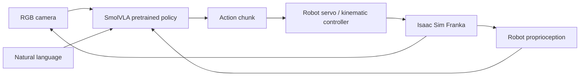

# Implementation plan

Started 2026-10-04. This is a living record; measured results will be linked as
milestones finish. An implemented feature is not considered validated until run.

## Architecture and scope

The user's final instruction selects **Isaac Sim**, superseding the earlier
MuJoCo preference and Isaac Sim exclusion. V1 uses standalone Isaac Sim Python,
a Franka Panda arm with parallel gripper, one RGB camera, four colored cubes,
and four physical, open-top containers. No ROS, Isaac Lab, detector, LLM planner,
reinforcement learning, or cloud service is part of the control path.

## Proposed implementation choices

- Environment: dedicated Conda environment named `vlarobot`; leave system Python
  and existing environments alone. Inspect dependency constraints before pinning.
- Simulator: a supported pip Isaac Sim release, selected after checking current
  NVIDIA documentation and LeRobot dependencies. Use CPU PhysX for this single
  scene if it improves reproducibility; RTX rendering supplies the RGB image.
- Robot: NVIDIA's Franka Panda USD asset. Articulated joints and contact physics,
  with real grasping rather than attaching/teleporting objects during control.
- Proposed action: 7D Cartesian incremental pose plus gripper, converted to
  joint targets through deterministic IK. If a tested Isaac controller makes
  joint position targets more reliable, select 7 arm targets + gripper instead
  and document that decision before collection. The VLA still predicts actions.
- Observation: RGB, measured robot joint/gripper state (and measured end-effector
  pose if Cartesian control is selected), and the instruction. Object poses and
  canonical task IDs are excluded from the policy input.
- Timing: aim for 10 Hz policy/control observations and 120 Hz physics, with
  explicit timestamps and documented units. Begin with a 256x256 camera.
- LeRobot: use the current official `LeRobotDataset` API and official SmolVLA
  preprocessing/training utilities. Pin the tested release or commit. Dataset
  frames contain the observation **before** the recorded action is executed.
- Expert: finite-state pick, grasp, lift, transfer, place, release, retreat.
  Simulator truth is available only to this teacher and the evaluation metric.
- Data: at least 100 randomized expert validation episodes, targeting >95%
  success, then 50 successful demonstrations for the first controlled experiment.
  Canonical source/destination, instruction, seed, and outcome stay in metadata.
- Splits: disjoint episode seeds; separate held-out language templates and
  source/destination combinations; later lighting, camera, and scale changes.
- Training: first load the official `lerobot/smolvla_base` checkpoint and measure
  a CUDA inference pass. Then a short fine-tune, verify loss/checkpoints, then a
  larger run as resources permit. Retry CUDA OOM with a reduced batch size. Keep
  logs local. Do not label a short sanity run as a fully trained policy.
- Inference: execute a configurable prefix of predicted chunks and observe again;
  use exactly the dataset's state/action semantics and saved normalization.
- Evaluation: physical containment, stable placement and released gripper;
  per-episode CSV/JSON, Wilson confidence intervals, recordings, and conservative
  failure labels. Never substitute expert actions in a VLA rollout.

## Milestones and gates

1. Inspect hardware; choose, install, and record compatible dependencies.
2. Launch/render the robot scene; verify reset, camera, and actions.
3. Make the expert reliable on 100 randomized episodes before collecting data.
4. Export, inspect, and visually review a real LeRobot dataset.
5. Verify pretrained SmolVLA shapes, CUDA, preprocessing, and forward inference.
6. Run short training, then longer training; record actual resource use/results.
7. Run closed-loop evaluation, generalization slices, videos, and failure analysis.
8. Finish educational docs and commands; run checks and commit each major stage.

## Expected technical risks

- Isaac Sim and LeRobot may require conflicting Python/PyTorch/NumPy versions.
  Resolve compatible pins first; if unavoidable, isolate the simulator process
  from policy dependencies using local IPC, without changing the VLA mapping.
- RTX 5070 Ti is Blackwell: PyTorch must include its CUDA architecture. The
  `nvidia-smi` CUDA version is driver capability, not a installed CUDA toolkit.
- RTX rendering and policy training contend for 16 GB VRAM. Collect first, close
  the simulator, then train; use conservative image sizes and batch sizes.
- USD asset downloads, extension startup, shader compilation, and first model
  download can be slow. Cache assets and retain logs; distinguish network errors
  from model or physics errors.
- Grasp friction, cube spacing, reachable poses, and release stability can make
  the expert unreliable. Fix physical/control causes before collecting.
- SmolVLA's pretraining embodiment differs from Panda. Fifty demonstrations are
  an experiment, not evidence of reliable language or compositional generality.
- Estimated long-run cost must come from the short benchmark. Any incomplete
  expensive run is reported honestly, with reproducible continuation commands.

## Official references to check before implementation

- https://docs.isaacsim.omniverse.nvidia.com/latest/installation/install_python.html
- https://docs.isaacsim.omniverse.nvidia.com/latest/index.html
- https://huggingface.co/docs/lerobot/installation
- https://huggingface.co/docs/lerobot/smolvla
- https://huggingface.co/docs/lerobot/lerobot-dataset-v3
- https://github.com/huggingface/lerobot
- https://huggingface.co/lerobot/smolvla_base

## Status

Machine inspection complete. Dependency selection and installation in progress.
No simulator, expert, model, or training result has been claimed yet.
