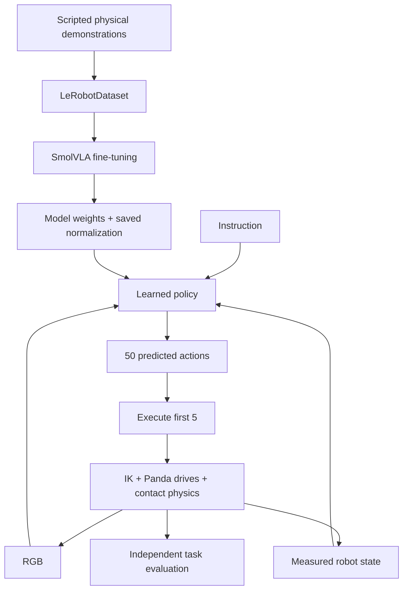
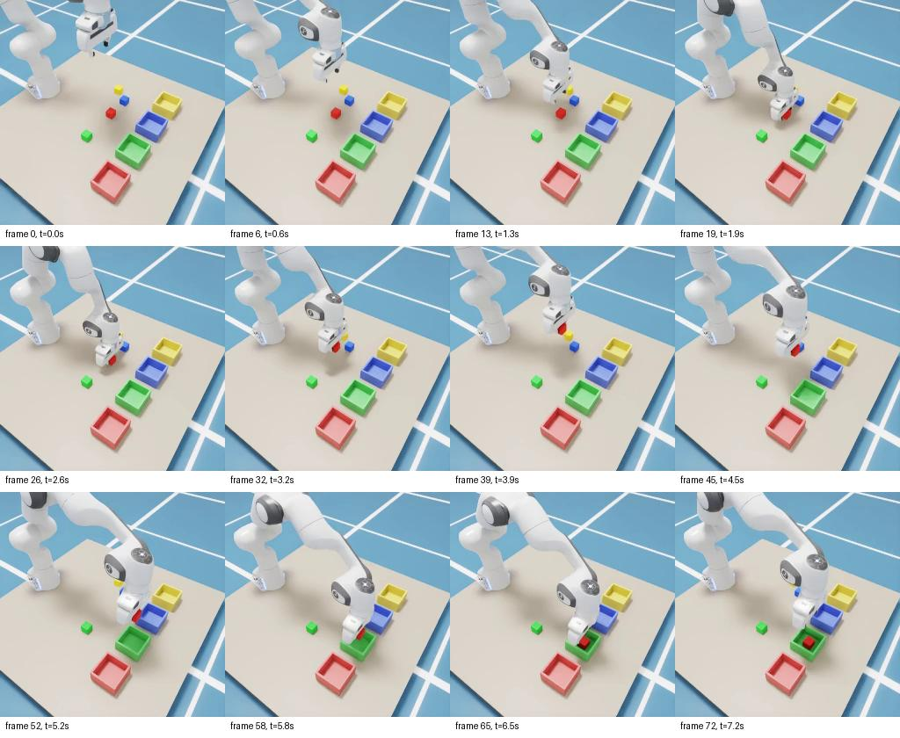
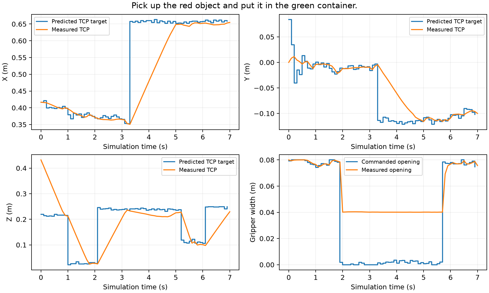
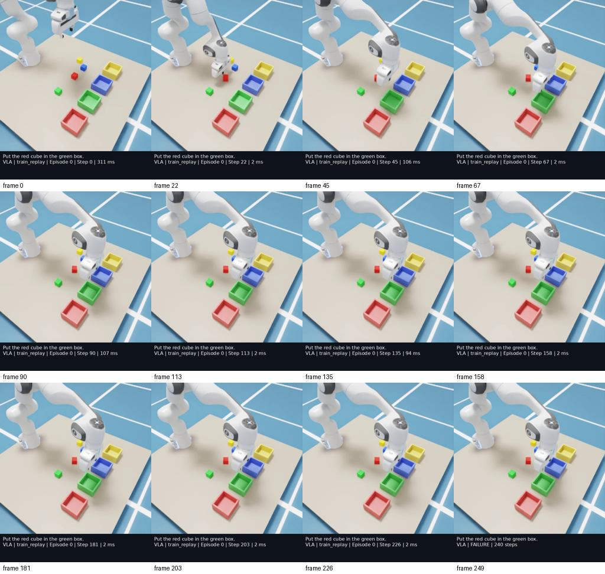
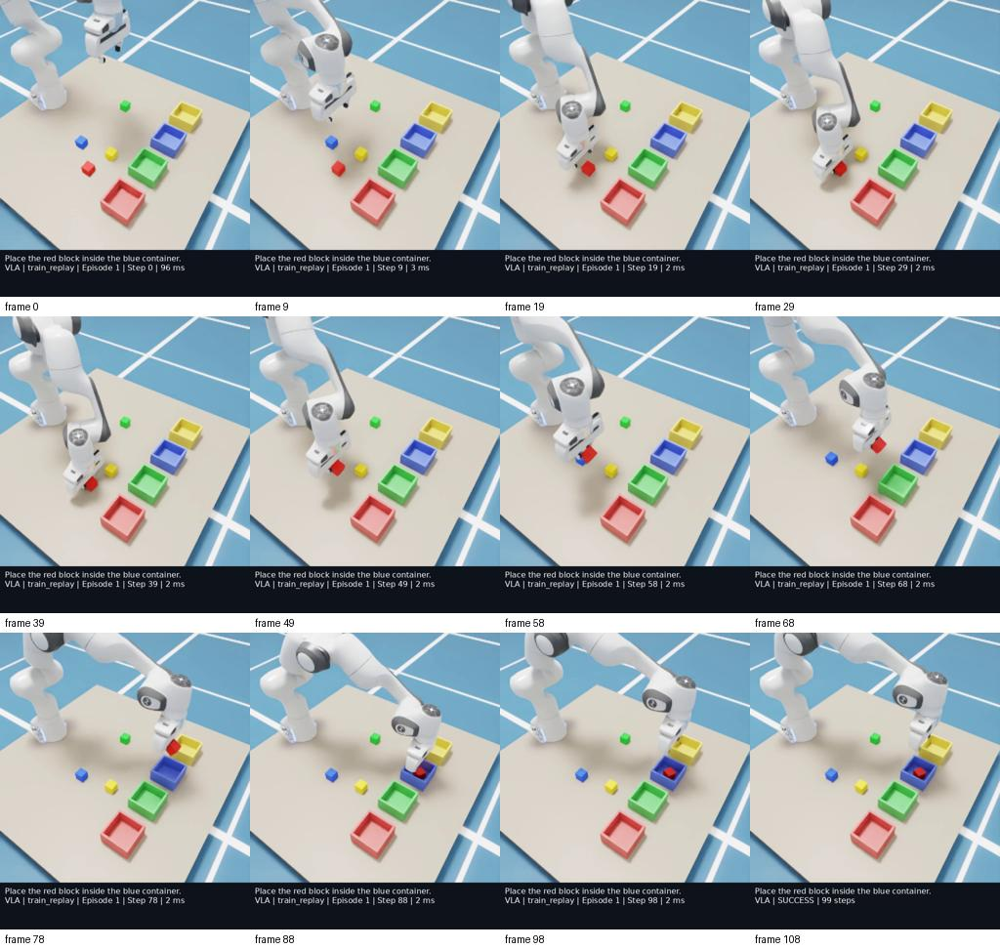

# Learning VLA through this robot

Read this alongside the source and actual demonstration videos. The equations
describe learning; the runnable implementation uses LeRobot's existing SmolVLA
and trainer. The action-format example is illustrative; the section labeled
“Walk through an actual successful rollout” uses recorded measurements.

## What is a VLA?

A Vision-Language-Action policy maps visual observations, an instruction, and
robot measurements into actions. In this project, it should look at four cubes
and four boxes, interpret “Put the green cube in the red box,” and predict how
the Panda should move and open or close its gripper.

Write the policy as:

\[
\hat a_{t:t+H-1} \sim \pi_\theta(I_t,\ell,s_t).
\]

`I_t` is the current RGB image, `ℓ` is the instruction, `s_t` is robot state,
and `H=50` is the action chunk length. The output is a distribution over
continuous actions, not a sentence telling another agent what to do.



## What are the vision inputs?

One 256×256 RGB camera sees the tabletop. Its image contains appearance and
perspective, not explicit object coordinates. Red/green/blue/yellow regions are
pixels. The vision encoder transforms image patches into numerical features,
which later attention layers can use to condition actions.

We do not pass depth maps, masks, object IDs, bounding boxes, perfect cube poses,
or a destination location to the model. Rendering an RGB image from a simulator
is analogous to receiving a camera image on a real robot. Reading cube poses from
the simulator and feeding them into the learner would be a different experiment.

Try the dataset contact sheet: watch how the image changes during descent, closure,
lift, and release. Note where the gripper occludes the cube. Those are exactly the
visual conditions the learner must handle.



These are decoded frames from a physical scripted demonstration in this project,
not generated illustrations or evidence of learned-policy success.

## How is language represented?

The instruction is tokenized into integer IDs. Learned embeddings turn those IDs
into vectors. “Cube,” “block,” and “object” need not share one token, but pretrained
representations can encode related meanings. Attention combines text-derived
features with image context. The model does not need our canonical `source` or
`destination` metadata in order to receive the task.

The project keeps the original instruction unchanged at the policy boundary.
The official SmolVLA processor supplies its expected newline/tokenization format.
Training uses five controlled templates; evaluation includes three unseen ones.
Successful paraphrase transfer would be evidence about those phrases and this
task distribution, not unlimited natural-language understanding.

## What is robot state?

Our 14 values are measured TCP position/orientation, total gripper opening, and
seven arm joint angles. TCP pose is computed from the robot's kinematic model and
joint measurements. These are realistic proprioceptive measurements.

For a roboticist, think of the information normally provided by joint encoders
and forward kinematics, rather than a world model built by perception. The policy
gets the robot's own configuration; it does not get a table of objects in the world.

## What are actions?

An action is seven continuous numbers:

```
[TCP target x, y, z, roll, pitch, yaw, gripper opening fraction]
```

For illustration, `[0.43, -0.12, 0.22, π, 0, 0, 1]` means an open, downward-facing
gripper target above a point on the tabletop. The next target might lower Z,
and a later action might set the last component to zero to close the fingers.

The model emits normalized values internally. The saved postprocessor restores
metres, radians, and opening fraction. The Cartesian servo clips/rate-limits the
target and computes joint commands. Motor drives and contact physics produce
the actual motion. A desired opening of zero does not make the fingers pass
through a cube; the measured opening remains positive during a physical grasp.

## What is action chunking?

Instead of predicting one action, the model predicts a short future sequence.
That can represent a coherent descent or lift and reduces repeated computation.
Our default predicts 50 actions, executes only five, and then predicts again from
the updated image/state. This is receding-horizon control with a learned action
sequence generator, rather than optimization against an explicit dynamics model.

At 10 Hz, five executed actions cover 0.5 simulated seconds. A new image arriving
during that interval does not alter actions already in the official queue. This
is the feedback delay to keep in mind when studying failures. Compare execution
prefixes of 1 and 5 using the same checkpoint and seeds; changing the prefix is
an inference experiment, not a retraining step.

## What is imitation learning?

Imitation learning learns behavior from examples of another controller. Here the
teacher is a scripted state machine with access to exact object positions. It
uses those positions to generate real contact-based pick-and-place episodes.
The learner sees the resulting RGB/state/language/action records, not the
teacher's privileged inputs or internal phase variable.

The teacher's information advantage is normal for this data-generation setup.
The restriction is at the learner boundary. Evaluation also needs ground truth
to score containment, but scoring does not choose the learner's action.

## What is behavioral cloning?

Behavioral cloning is supervised imitation: fit a conditional policy to expert
actions on expert observations. A simple regressor could minimize
`||predicted_action - expert_action||²`. SmolVLA instead uses a flow-matching
objective over action chunks, but the supervision still comes from recorded
expert behavior. We do not optimize an environment reward through exploration.

The distinction matters: the learner may visit a state absent from the expert
dataset. After a missed grasp, the picture looks unlike a successful expert lift.
The model has no guarantee of knowing how to recover. Small local errors can
therefore compound into complete episode failures.

## Why do we need demonstrations?

They connect this camera appearance, robot state convention, and command language
to the actions this robot needs. A pretrained model has useful representations
and manipulation priors, but it has not automatically calibrated this Panda's
TCP frame, target units, contact geometry, or container layout.

Fifty identical trajectories would provide almost no evidence about changing
positions. Our resets move the four cubes while keeping the scene controlled.
The learner must encounter enough successful approaches and grasps across that
space. More data can help; diverse, correct, synchronized data matters more than
blindly increasing the episode count.

## What does SmolVLA already know before fine-tuning?

Its pretrained vision-language backbone provides visual/text representations,
and the base action expert was pretrained on robotics demonstrations. This gives
a starting point for interpreting appearances and learning manipulation behavior.
It does not imply zero-shot mastery of a new arm or action convention. The
published model is about 450 million parameters and combines a compact
vision-language model with a flow-matching action expert.
[Official introduction](https://huggingface.co/blog/smolvla),
[technical report](https://huggingface.co/papers/2506.01844).

In our smoke test, an output with the correct shape and finite values proves
that the architecture accepts the new contract. It does not prove that a “red”
token selected the red cube or that a predicted grasp is physically viable.

## What exactly are we fine-tuning?

We load the full official SmolVLA base weights. With the default upstream settings,
the vision-language backbone is frozen while the action expert and associated
trainable projections adapt to the demonstrations. The exact trainable parameter
count is recorded by the smoke test; inspect the installed configuration/source
if changing the freezing flags.

The representation changes from the base embodiment's feature schema to 14 state
dimensions, seven action dimensions, and one camera. Internal padding supports
these widths. Normalization is also adapted using this training dataset; using
the original robot's means/stds at inference would give the wrong physical units.

Freezing the backbone does not make images irrelevant: its output features still
enter the trained action expert. It means we do not update those feature-extractor
weights during this particular fine-tune.

## What is flow matching in this context?

Let `A` be a normalized expert action chunk and `ε` random Gaussian noise. One
useful way to understand the objective is an interpolated noisy chunk:

\[
x_t = t\epsilon + (1-t)A, \qquad u_t = \epsilon-A.
\]

The action expert predicts this velocity field from `x_t`, flow time `t`, and
the visual/language/state context. Squared error against the target field trains
the model. At inference it starts from noise and integrates toward actions.
The implementation's exact time convention and masks are in the pinned upstream
`modeling_smolvla.py` and common flow-matching helpers. Padding masks prevent
out-of-episode targets from being treated as real continuation data.

Noise here is a way to model the conditional action distribution. It is not
reinforcement-learning exploration in the simulator.

## How does an image eventually influence a motor command?

Trace a single decision through actual files:

1. `simulation/camera.py` reads an RTX RGB frame after the current physics state.
2. `inference/policy.py` converts HWC uint8 pixels into CHW float tensors and
   admits only those pixels, robot state, and instruction.
3. Official processors batch/tokenize/normalize the input.
4. SmolVLA turns image/text context into features used by the action expert.
5. The action expert predicts a normalized 50×7 chunk. Its feature dependence
   lets a changed picture change the action distribution.
6. The official postprocessor restores physical action units.
7. `control/ik_controller.py` converts the predicted TCP pose to Panda joint
   targets. It does not choose a cube or a destination.
8. Joint drives move the links. Contacts may grasp, push, slip, or drop the cube.
9. The next rendered image closes the loop.

There is no intermediate “red cube at XYZ” message produced by a detector.
Interpreting image features is distributed across the learned network rather
than exposed as a hand-designed object table.

### Walk through an actual successful rollout

The corrected 3,000-step policy completed development seed 100000 for “Pick up
the red object and put it in the green container.” These are rounded measurements
from that run, not illustrative or expert-generated actions. Each row shows the
state **before** its predicted action is executed. Positions/widths are metres.

| Step | Measured TCP XYZ | Predicted target XYZ | Opening command | Measured width |
|---:|---|---|---:|---:|
| 0 | (0.417, 0.000, 0.432) | (0.416, 0.084, 0.219) | 0.990 | 0.080 |
| 20 | (0.372, −0.012, 0.028) | (0.370, −0.012, 0.027) | −0.002 | 0.040 |
| 30 | (0.365, −0.009, 0.204) | (0.365, −0.016, 0.238) | −0.006 | 0.040 |
| 40 | (0.479, −0.060, 0.218) | (0.660, −0.119, 0.238) | 0.016 | 0.040 |
| 60 | (0.652, −0.109, 0.101) | (0.657, −0.102, 0.106) | 0.976 | 0.077 |
| 69 | (0.653, −0.096, 0.215) | (0.659, −0.102, 0.249) | 0.935 | 0.079 |

At step 20 the predicted opening is slightly negative; the actuator interface
clips it to zero. Yet measured width stays near 0.04 m because the fingers contact
the cube. At step 40 the model predicts a target well ahead of the measured TCP;
the servo advances by at most 0.025 m per interval. At step 60 it opens, and the
cube rests at Z≈0.028 m: the 0.008 m box floor plus half the 0.04 m cube. That last
object measurement belongs to the evaluator, not the policy input.



The plot shows why an action target is not an instantaneous robot pose. Dynamics,
rate limits, contact, and subsequent feedback connect the two. The rollout also
illustrates a limitation: the first target was imprecise, and success required a
sequence of later predictions. One successful sequence does not imply reliable
object selection or recovery on other scenes; the failed videos remain essential.

Regenerate this figure with `scripts/plot_results.py --trace` using the JSON trace
under `outputs/evaluation_fp32_restored_pilot/traces/position_0000.json`.

### Compare a missed grasp after more training

The 20,000-step model failed training-scene replay episode 0, “Put the red cube
in the green box.” Its closest TCP-to-cube distance was **2.82 cm** and the red
cube rose only **2.3 mm**. The gripper nevertheless continued toward the green
container; at timeout its TCP was around `(0.657, −0.089, 0.239)` while the red
cube remained on the table. This is observable failure to acquire and recover
the target, not evidence that the model misunderstood the word “green.”



Episode 1, “Place the red block inside the blue container,” succeeded in 99
steps. The target rose **21.3 cm** and settled at `(0.668, 0.086, 0.028)` inside
the blue box. Both scenes came from training, so this comparison teaches contact
and recovery behavior; it does not establish unseen-position generalization.



For an exercise, open the two `train_replay_0000/0001.json` traces under
`outputs/evaluation/traces/`. Plot commanded and measured gripper opening
alongside TCP motion. Identify the earliest evidence that the first grasp missed.
Then ask which successful demonstration contains the corresponding recovery
behavior. Our dataset contains no deliberate failed-grasp recovery examples,
which limits what behavioral cloning can learn about those states.

## How does language affect the actions?

Language provides context to the action-generating network. With the same image
and state, changing “red cube” to “green cube” should change which region the
gripper approaches; changing “blue box” to “yellow box” should change placement.
That is a hypothesis to test in rollouts, not a property guaranteed by using a VLA.

Our controlled phrases let us separate word substitutions, unseen wording, and
unseen source/destination pairings. Because bins have fixed positions, a model
could learn a color-word-to-location association rather than fully infer container
locations visually. Swapping bin positions/colors would test a stronger form of
grounding and should be a separately reported later experiment.

## Why does the model need robot state in addition to images?

Images can hide joint angles and gripper opening through occlusion or projection.
Similar pixels can correspond to different robot configurations. Proprioception
anchors what motion is currently being executed and how far the gripper is from
its target. During grasp closure, the image alone may not clearly distinguish
an empty closed gripper from contact with a partly occluded cube.

The redundant arm angles also identify the posture of a seven-DOF arm, whose
end-effector pose does not uniquely determine joint configuration. Supplying
state does not eliminate the need for vision: state alone cannot locate the
randomly placed target cube.

## How is this different from an LLM commanding MoveIt?

In an LLM+planner system, perception might produce poses, the LLM might choose
“pick object 3,” and a planner might generate the trajectory. Here, the learned
model itself predicts the continuous motion and gripper sequence. The final IK
conversion is comparable to a robot's ordinary low-level command interface; it
is not a semantic manipulation planner.

This changes both engineering and debugging. An explicit planner offers explicit
collision geometry and constraints. Our VLA learns a behavior distribution and
can fail in ways not explained by one symbolic plan. Servo clipping limits the
interface but does not certify collision-free motion.

## How is this different from reinforcement learning?

Reinforcement learning improves a policy using rewards from interactions, often
with exploration and credit assignment over many trajectories. This project uses
supervised expert data. The success metric measures performance and filters
expert demonstrations; it is not fed into an RL optimizer. No reward-driven
policy update occurs during evaluation.

VLA describes an input/output architecture; imitation learning and RL describe
ways of training. A VLA could be trained or refined with RL in another project,
but that is outside this version.

## What does embodiment mean?

Embodiment includes arm geometry, joint limits, gripper design, cameras, sensors,
action representation, timing, and contact behavior. A motion suitable for a
small servo arm is not automatically suitable for a Panda. Even two Pandas with
different TCP definitions or camera poses can present different learning problems.

The two Python environments are a software packaging detail. Switching the
robot's kinematics or action semantics is an embodiment change. Keeping those
concepts separate helps explain why loading a checkpoint is much easier than
transferring a successful policy to hardware.

## Why might a VLA generalize to new instructions?

Pretrained representations can associate related words and appearances, and the
action expert can combine contextual features in ways not seen verbatim during
fine-tuning. Our held-out green → blue task tests one such recombination when the
learner has seen green grasping and blue placement in other combinations.

However, compositional generalization is an empirical question. Enough examples
of the ingredients do not guarantee the model learns the desired factorization.
Report separate position, language, and composition results with uncertainty.

## Why can it fail on apparently simple tasks?

A grasp requires small spatial errors, good timing, correct opening, and sustained
contact. A one-camera view may make two nearby heights look similar. The gripper
can occlude the target; a chunk can continue after the cube slips. The expert may
never demonstrate recovery. Dataset imbalance can make one color dominate.
Normalization/frame mistakes can turn a good normalized prediction into a bad
physical command.

Inspect failure videos and actions together. First rule out software contract
errors (channel ordering, metres/radians, action timing, checkpoint statistics).
Then ask whether the dataset covers what the policy experienced. Do not infer
“language misunderstanding” from every wrong-object trajectory; visual ambiguity
or biased actions could produce the same symptom.

## Limitations of this experiment

One rigid cube task, a fixed tabletop/camera baseline, colored geometric objects,
fixed container positions, one arm, and a small scripted dataset are a teaching
environment. The expert has near-perfect sensing and mostly successful behavior;
the learner has neither sensing privilege nor recovery coverage. The orientation
distribution is narrow. The simulator is paused during neural computation, so
results do not establish real-time hardware control.

Even a high success rate here would not establish industrial reliability,
arbitrary language following, safety guarantees, or sim-to-real transfer. The
value is that every boundary—from demonstrations and normalization to actions
and physical scoring—is inspectable and experimentally testable.

## Suggested learning experiments

Keep one factor fixed while changing another: 50 vs 100 vs 250 demonstrations;
execution prefix 1 vs 5; training phrases vs held-out paraphrases; known pairs vs
held-out combinations; then lighting, camera, and scale individually. Use paired
seeds, retain failures, and report intervals. A useful notebook exercise is to
plot TCP target versus measured TCP and gripper command versus measured opening
for a successful expert episode and a failed VLA rollout.

## Future versions (not implemented)

| Version | Extension | What must change or be validated |
|---|---|---|
| V2 | Push, stack, sort, multiple tasks | New experts/data/metrics; broader contact and recovery coverage |
| V3 | Isaac Lab + domain randomization | Environment adapter and calibrated variation ranges; keep evaluation controlled |
| V4 | ROS 2 integration | Sensor timestamps and action bridge; use existing Jazzy where appropriate |
| V5 | Real arm | Calibration, controller limits, delays, real data, guarded hardware trials |
| V6 | Mobile manipulator | Base/arm action contract, moving-camera observations, longer horizons |
| V7 | Industrial applications | Task-specific tooling, fault detection, repeatability, verified recovery and operational constraints |
